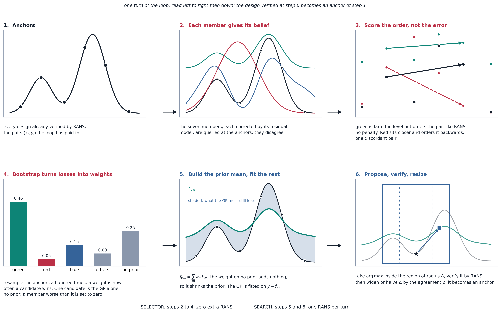

# Reliable and Economical Aerodynamic Shape Optimization

**Black-box Gaussian-process Bayesian optimization with an online-selected surrogate prior**

[](LICENSE)


Master thesis, Jules Haustraete — MSc Mechanical Engineering, ETH Zurich, carried out at the
Computer Vision Laboratory (CVLab), EPFL. Supervisor Prof. Mark Fuge, co-supervisors
Prof. Pascal Fua and Edouard Dufour.

📄 **[Read the thesis (PDF)](thesis/MasterThesisJulesHaustraete.pdf)**

---

## In short

Optimizing an airfoil against a RANS solver costs minutes per evaluation, while a zoo of cheap
estimators (NeuralFoil, MLPs trained on RANS data, AirfoilANN, XFoil) claims to predict the same
physics. This repository contains the optimizer and the trained zoo used in the thesis to test two
ways of using that zoo:

1. **As a gate**: trust a surrogate wherever its uncertainty is low and pay for RANS only elsewhere.
   *Refuted:* the designs the optimizer elects are exactly where the surrogates overrate themselves,
   so the gate saves nothing. Verifying every design is a necessity (Chapter 4).
2. **As a prior**: use a surrogate as the prior mean of the Gaussian process, and let the loop choose
   which member online, by how well each one *orders* the designs already verified (RGPE-style).
   *Works:* on nine cases, the median number of RANS evaluations to reach 98 % of the reference
   plateau goes from 70 (POD-8 latent search space) to 58 (better acquisition) to 16 with the prior
   chosen online; naming the best member by hand would give 12 (Chapter 5).

The same surrogates fail as a substitute for the truth and succeed as a guide: replacing an evaluation
needs the *magnitude* to be right where the optimizer looks, guiding a search needs only the *order*.

## How it works

```
CST-22 shape ──► POD-8 latent ──► GP Bayesian optimization ──► SU2 RANS
                                              ▲
                  zoo of 7 surrogates ────────┘ prior mean or gate
```

- **Shape**: 22 CST coefficients, searched in an 8-mode POD latent fitted on 7 468 real airfoils.
- **Truth**: SU2 v8.5 RANS (Spalart–Allmaras) on a gmsh C-mesh generated per design.
- **Zoo** (`src/zoo.py`): seven members, the global network, two regime experts and two source
  models trained on a harmonised multi-source RANS dataset, NeuralFoil and AirfoilANN, all behind
  `zoo.predict(member, cst22, mach, alpha, Re)`. The library also exposes the networks rejected by
  the admission check of the thesis appendix, and XFoil.
- **Uncertainty** (`src/opt/iocue.py`): IO-CUE heads per member, gradient-boosting median bias and
  conformal quantile, refit at load time from residuals stored against RANS (`models/iocue_v4`).


*One turn of the final loop. The members are scored on the order they put on the designs already
verified, not on their error; bootstrap weights build the prior mean; the GP learns the rest inside a
trust region. Selecting costs no extra RANS evaluation.*

## Repository

```
main.py                 single entry point: optimize, predict, and the training chain
src/zoo.py              the model library: every member of the zoo behind one call
src/opt/brain_bo.py     the optimizer (GP-BO, gate, prior, RGPE selection, trust region)
src/opt/                SU2 driver and cases, batch evaluation, IO-CUE, prior selection, CST geometry
training/               POD, zoo MLPs, probe set, IO-CUE residuals
models/                 trained zoo, IO-CUE residuals, POD modes (~48 MB)
data/su2_probe.parquet  our SU2 solutions on probe airfoils (training of the final IO-CUE heads)
thesis/                 the thesis PDF
Dockerfile              SU2 8.5 + gmshairfoil2d + the Python stack
```

## Install

**Docker (recommended, CPU-only image with SU2 and the mesher):**

```bash
docker build -t thesis-aero .
docker run -it --rm --cpus 4 -v "$PWD":/workspace thesis-aero
```

**Local:** Python ≥ 3.11, `pip install -r requirements.txt` (it includes the mesher), and the
[SU2 8.5.0](https://github.com/su2code/SU2/releases/tag/v8.5.0) binary for the RANS truth:

```bash
export SU2_BIN=/path/to/SU2_CFD GMSH_BIN=$(which gmshairfoil2d)
```

XFoil is optional (`XFOIL_BIN`, or `xfoil` on the PATH); without it the XFoil member returns NaN and
is never selected.

## Use

Query the zoo:

```bash
python main.py predict global --airfoil naca0012 --mach 0.3 --alpha 4 --re 6e6
```

```python
from src import zoo
cl, cd = zoo.predict("neuralfoil", cst22, mach=0.15, alpha=5.0, Re=6e6)
```

Check the optimizer in a few minutes, NeuralFoil standing in for RANS:

```bash
python main.py optimize prior 1 --fid neuralfoil --budget 10
```

A real run, 100 SU2 evaluations on 4 cores, about a day:

```bash
python main.py optimize <arm> <case> --seed 42
```

| arm | what it is | thesis |
|---|---|---|
| `baseline` | expected improvement on the 22 CST coefficients, every design verified | §3.5, §5.1 |
| `reference` | PIMS acquisition in the POD-8 latent, every design verified (reference loop) | §3.5, Ch. 5 |
| `gate` | trust a zoo member when its σ̂ < 20 % of the base performance | Ch. 4 |
| `prior` | surrogate prior mean chosen online (RGPE) + trust region with restart | Ch. 5 |

| # | case | Mach | Re | objective |
|---|---|---|---|---|
| 1 | NACA 0012, α = 5° | 0.15 | 6e6 | max L/D |
| 2 | NACA 0012, α = 3° | 0.50 | 6e6 | max L/D |
| 3 | NACA 0012, α = 4° | 0.30 | 6e6 | max L/D |
| 4 | RAE 2822 off design, α = 3° | 0.734 | 6.5e6 | max L/D |
| 5 | NACA 0012 low Re, α = 5° | 0.10 | 3e5 | max L/D |
| 6 | NACA 0012 near stall, α = 9° | 0.15 | 6e6 | max L/D |
| 7 | NACA 4412, α = 3° | 0.30 | 1.2e7 | max L/D |
| 8 | NACA 0012, C_L* = 0.5 | 0.15 | 6e6 | min C_D |
| 9 | NACA 0012, α = 1.25° | 0.80 | 3e6 | min C_D |

The thesis reports three seeds (42, 123, 456) per arm and case. Each run writes
`results/<arm>_<case>_s<seed>/traj_brain_*.parquet`, one row per evaluated design (CST, member used,
belief and σ̂, verified value, RANS spent), and the best shape as `best_cst22_*.npy`. Every other
switch of the optimizer is a `BRAIN_*` environment variable read at the top of `src/opt/brain_bo.py`.

## Hardware and reproducibility

The thesis runs were done on the Research Computing Platform (RCP) of EPFL, a Kubernetes cluster,
in a PyTorch 2.1 CUDA image with the same SU2 and mesher as the `Dockerfile` here, which is a lighter
CPU-only version. Nothing depends on the cluster itself: it only ran many independent jobs in parallel.

| | thesis setting | on a laptop |
|---|---|---|
| one optimization run | 1 job, **4 CPU cores, 12 GB RAM, no GPU**, about 17 h for 100 fast SU2 evaluations | same on any 4-core Linux machine; the image is linux/amd64 |
| full campaign | 9 cases × 4 arms × 3 seeds, plus the ablations: several hundred runs in parallel | out of reach sequentially (months); run a few cases |
| zoo training | one GPU, seconds per member | CPU works, minutes per member |
| optimizer on a surrogate truth (`--fid neuralfoil`) | — | minutes, no SU2 needed |

- **Threads**: SU2 is an OpenMP build. Set `OMP_NUM_THREADS` to the cores you give it (`main.py`
  sets 4); otherwise it starts one thread per core of the host and becomes orders of magnitude
  slower on a shared node.
- **Determinism**: with the same seed and the same library versions, a run is reproduced exactly
  (checked on the surrogate truth). SU2 matched across machines where we checked it: the starting
  airfoil of case 1 gives L/D = 54.909258 both on the cluster and in the Docker image on a laptop.
  Another software stack does change the trajectory: in the Docker image the same run is identical
  through its initial designs, then picks a different first guided design, because scikit-learn
  refits the IO-CUE heads at load time and the GP is fitted by another BoTorch. This is why the
  thesis reports medians over three seeds: expect the same conclusions, not the same digits.
- **Versions**: SU2 8.5.0, gmsh 4.15.2 and gmshairfoil2d 0.2.33 everywhere. The thesis image had
  Python 3.10, NumPy 1 and PyTorch 2.1 (the mesher in a separate Python 3.11 environment), with
  BoTorch and GPyTorch installed unpinned at the start of each job in September 2026. This release
  was checked locally (NumPy 2.0, PyTorch 2.3, BoTorch 0.17.2, scikit-learn 1.6) and in the Docker
  image (Python 3.11, NumPy 2.4, PyTorch 2.14 CPU, BoTorch 0.18.1, scikit-learn 1.9).

## Training (Chapter 2)

The trained models are shipped; retraining needs the harmonised RANS dataset
(`data/dataset_v4_clean.parquet`, built from the public sources of Section 2.2, not redistributed here).

```bash
python main.py train-zoo       # 10 MLP networks  -> models/plan4_v4, models/source_v4
python main.py build-probe     # probe set        -> data/common_probe.parquet
python main.py fit-pod         # POD latent       -> models/pod_cst.npz
python main.py predict-probe   # zoo on probe     -> data/predictions_all.parquet
python main.py train-iocue     # IO-CUE vs data   -> models/iocue_v4/*_resid.npz
python main.py fit-iocue-su2   # IO-CUE vs SU2    -> models/iocue_v4/*_resid_su2probefix.npz
```

The last step runs on the shipped `data/su2_probe.parquet` and needs nothing else.

## Not included

The RANS training datasets (from the public sources cited in Chapter 2), the run trajectories behind
the figures, and the exploratory experiments of the thesis. Available on request.

## Citation

```bibtex
@mastersthesis{haustraete2026aero,
  title  = {Reliable and Economical Aerodynamic Shape Optimization:
            Black-Box Gaussian-Process Bayesian Optimization
            with an Online-Selected Surrogate Prior},
  author = {Haustraete, Jules},
  school = {ETH Zurich},
  note   = {Carried out at the Computer Vision Laboratory, EPFL},
  year   = {2026}
}
```

MIT licence. AirfoilANN weights from Khan et al., MIT licence (`models/airfoilann/LICENSE`).
NeuralFoil by P. Sharpe.
